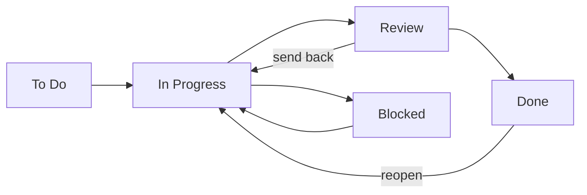

# Work Board: Managers' Workboard

**Status:** Phase 1 built and being tested · **Written:** 16 Oct 2026, read through and corrected 19 Oct 2026 · Supersedes the 12 and 14 Oct plans (Keka scope, members, self-created tasks)

A lightweight board for the Engineering managers. Managers create and assign tasks to their own team. Team members never sign in. NPI is the sandbox. Slack comes in Phase 2.

*This file lives in `plan/`, which is not gitignored, so it is tracked. It contains no names or emails.*

**Deferred to a later branch:** standup suggestions (tasks proposed from the standup messages, with a manager review step) and the weekly handover checklist. Both were moved out of this branch; the plan for them travels with the snapshot folder `workboard-suggestions-snapshot` next to the project.

## 1. What changed from the earlier plans

- **Managers only.** No member board, no member-created tasks, no "Self-created" badge.
- **No Keka, no reporting-line scope.** Who sees what is decided by teams the admin sets up, not by an org chart.
- **Teams, one-to-one in Phase 1:** one team has one manager, a manager runs one team, a person is on at most one team, a team has one board.
- **The manager moves every card**, since nobody else can. Review stays as a column.
- **Slack is Phase 2** (notify, Accept, comment sync). Phase 1 has no alerts beyond header badges.

## 2. Phases

**Phase 1: Managers' Workboard.** Manual task creation (title, description, assignee, due date, priority); admin Teams portal; manager My team; board, task detail, comments, timeline, report. Validated with the NPI sandbox.

**Phase 2: Slack bot and the weekly directory pull.** A weekly pull from the Slack API refreshes the people directory (in Phase 1 the directory loads from a file with `make db-seed`). The bot: notify assignees about tasks and deadlines; an Accept button (a task stays To Do until accepted, and acceptance shows on the board); assignees send comments, questions and progress from Slack, synced into the task's comments (`source = slack`); requesters can add context. Managers keep working in the Workboard. The data model already carries `accepted_at` and comment `source` so Phase 2 adds no migration of existing rows.

## 3. People and roles

Everyone is one row in the people directory (name, email, Slack ID, from Slack). A person has a **team role** (`member` or `manager`) and, separately, an **admin flag**, so an admin can also be a member or manager of a team.

| Kind | Who | Signs in | Role in the app |
|---|---|---|---|
| **Admin** (flag) | Anyone an admin makes admin | Yes | Runs the Teams portal and can read every team's board, **read-only** (no create, edit or move), but may comment on any task that is not Done. Creates and deletes teams, changes managers, adds and removes people on any team, makes or revokes admin (an admin may be only an admin, on no team; at least one always remains). If they also run a team they act on that team only. |
| **Manager** (role) | One person per team | Yes | Runs one team: board, My team. Can assign tasks to themselves like any team member. |
| **Member** (role) | A person on a team, or on none | No (unless also admin) | In the directory. Only ever an assignee. |

A signed-in user who runs no team (and is not an admin) sees **"You are not on any team yet. Ask an admin to add you to one."** Home (`/`, the logo) is always a Kanban board for every role: a manager's own, or, for an admin who runs no team, the read-only board of a team they choose. "Team boards" in the avatar menu opens any team's board read-only (a team dropdown shows each team and its manager; the choice is kept in the URL as `/boards/<team-name>`; the API takes `team=<id>`). The board opens on all tasks; "Needs attention" (overdue, blocked, in Review, needing a new owner) is a tick with its count that narrows the cards. The tick, person and filters are kept per team in `sessionStorage`, not in the URL.

### Team rules (enforced on the server only; the UI reads the `actions` the API sends and never re-implements a rule)

| Rule | Where |
|---|---|
| One manager per team; a manager runs one team | identity services + unique `teams.manager_id` |
| A person is on at most one team | `add_member` rules + `people.team_id` |
| Admin manages any team; a manager only their own | `security/authorization.py` |
| A manager sees, edits, moves, deletes and comments on only their team's tasks | `can_view_team`, `can_act`, `can_comment` |
| An admin reads any team's board, tasks, comments and timeline and may comment on any task that is not Done; they act on nothing else (unless it is the team they run) | `can_view_team`, `can_comment`, `can_act` |
| A due date is today or later; a Done task cannot be edited or reassigned | `tasks/services/commands.py` (`due_date_past`, `task_done`) |
| Which team a board request means: a manager's own (another is refused); an admin's choice | `resolve_board_team` in `tasks/services/queries.py` |
| Assignees must be active people on the manager's team, the manager included | `_assignee_on` in `commands.py` |
| Changing a manager makes the new one manager and the old one a member who stays on the team; the manager cannot be removed, only replaced | server `change_manager`, `is_manager` |
| Only an admin makes or revokes admin; the last active admin cannot be revoked | server `set_admin` |
| Only admins and managers sign in; an inactive person never does | `can_login` |

## 4. Admin Teams portal and My team

- **Admin (`/admin`):**
  - Create a team, giving it one first person from the directory, who becomes its manager.
  - Change a team's manager: choosing Manager for someone else demotes the current manager to member, who stays on the team. Setting the current manager to Member directly is refused; pick the replacement.
  - Delete a team: irreversible, asks for the team's name and a reason. Its people return to no team, the manager returns to member (an admin keeps admin), and the team's own data is erased. The audit log keeps one record of the deletion.
  - Add or remove people on any team (a dustbin on each person).
  - Make or revoke admin with a tick beside the Manager / Member dropdown, or from the **Admins** tab, which lists every admin (on a team or not) and can add anyone in the directory as an admin without putting them on a team. At least one admin always remains.
  - Read the audit log (team and membership changes, admin changes, task deletions and reassignments).
- **Manager (`/team`):** add people from the directory (a searchable "Name (email)" picker listing active people on no team: managers are hidden, admins are shown) and remove them with the dustbin. There is no Active / Inactive switch.
- A reason is required from an admin and optional from a manager, except adding a member, where it is optional for both. Every change is audited (actor, subject, reason, time, details).
- Removing someone keeps their open tasks; the dustbin's dialog warns how many will need a new owner (the members list carries each person's `open_task_count`: tasks not Done), and they show on the board as **needing a new owner** (banner, and an attention item).

## 5. Task lifecycle

The manager can move a card between any columns the server allows (`transitions_for` in `security/authorization.py`; the API sends them with each task). Reasons are mandatory for Blocked, moving back to To Do, send back and reopen; **any move to Done needs remarks** (accepting from Review included). A task can be deleted only while To Do or In Progress. Overdue is calculated, not stored. Done cards stay on the board, the most recently closed on top of the Done column.

## 6. Data model (Postgres, indicative)

| Table | Key fields |
|---|---|
| `people` (built) | id (UUID), slack_user_id (unique), email (unique, lowercase), name, role (`member` / `manager`), is_admin, team_id (nullable: a person is on at most one team), active (still in the Slack directory), created_at, updated_at. This replaces the separate `users` table. |
| `teams` (built) | id (UUID), name (unique, ignoring case), manager_id (unique, nullable), active, created_at, updated_at |
| `access_audit_log` (built) | id, actor_id, action, team_id, person_id, reason, details (JSON), created_at. Append-only, enforced by a database trigger. No foreign keys, so history survives deletes. |
| `tasks` (built) | id, team_id (cascade on team delete), title, description, status, priority, due_at (a date), creator_id (person), assignee_id (person), returned_count, accepted_at (Phase 2), created_at, updated_at, closed_at |
| `task_activity` (built) | id, task_id (cascade), actor_id (person), kind (`created` / `status` / `edit` / `reassign` / `comment`), source (workboard / slack), field, old_value, new_value, note, created_at. Timeline and comments in one table. A trigger refuses `UPDATE`; `DELETE` is allowed only so a deleted task or team takes its history with it. |
| `alert_log` (Phase 2) | id, task_id, event, recipient, dedupe_key (unique), sent_at |

## 7. API (the server implements it; the built endpoints are listed with their files in the feature READMEs)

| Endpoint | Purpose |
|---|---|
| `GET /board`, `GET /reports/team` | the team's cards and numbers (built) |
| `POST /tasks`, `GET / PATCH / DELETE /tasks/{id}`, `POST /tasks/{id}/status`, `POST /tasks/{id}/comments` | tasks (built) |
| `GET / POST /teams`, `DELETE /teams/{id}`, `PATCH /teams/{id}/manager` | teams, manager, delete (built; admin) |
| `GET / POST /teams/{id}/members`, `DELETE /teams/{id}/members/{person}`, `GET /people?unassigned=` | team membership and the picker (built) |
| `PATCH /people/{id}/admin`, `GET /audit-log`, `GET /me` | admin toggle, history, the signed-in person (built). The client builds its own "me" (team, assignable people, header counts) from `/me`, the team's members and `/board` |
| `GET /dev/accounts` | the development login's account list; a 404 unless `DEV_AUTH` is on (built, dev only) |
| `GET /reports/all-teams` | the admin's report across every team, with the people under each (built) |
| `GET /auth/google` | Google sign-in: send the browser to Google, with a random `state` (built; untested against real Google until the OAuth client and settings exist) |
| `GET /auth/google/callback` | Google returns here with a code; the server checks the verified `@atimotors.com` email and that the person is an active manager or admin, then redirects to `/login?code=` (or `/login?error=not_onboarded` / `domain_not_allowed`) (built) |
| `GET /auth/google/exchange?code=` | trade our one-time code for a signed, expiring session token, sent afterwards as `Authorization: Bearer` (built) |

The built endpoints are listed with their files in `server/identity/README.md`, `server/tasks/README.md` and `server/auth/README.md`.

The UI hides controls from the permission rules, but **every rule is enforced again on the server**.

## 8. Build plan

1. **UI first (done, then moved to the real API):** types, admin Teams portal, My team, board, "No team" page were built against an in-browser mock, which has since been deleted; the screens now use the server, including the admin Teams portal and My team (done 17 Oct). The day-by-day steps are in `docs/WORKLOG.md`.
2. **Backend:** FastAPI + Postgres (see `docs/DATABASE_DECISION.md`).
   - **Built:** the identity feature (`server/identity`): people, teams, managers, admin toggle, members, delete team, audit log, a directory loader. For development, `DEV_AUTH` adds a local-only "sign in as" stub beside Google sign-in.
   - **Also built:** the tasks feature (`server/tasks`): tasks, timeline and comments, the board query with filters and "needs attention", and the team report.
   - **Also built:** Google sign-in (`server/auth`): the three `/auth/google` endpoints, signed session tokens and one-time codes. It needs the OAuth client and the settings to be tried against real Google.
   - **Tested:** server tests with 100% line and branch coverage, client unit and component tests, and a Playwright smoke test (`make e2e`).
   - **Next:** try Google sign-in against real Google (needs the OAuth client and settings), the nginx container, HTTPS once there is a domain, and the browser pass in light and dark.
   - **Deployment:** the database and API containers exist; an nginx container serving the built frontend (HTTP only) is planned, HTTPS comes last once there is a domain. See `docs/DEPLOYMENT.md`.
3. **NPI sandbox**, then the other Engineering teams.
4. **Phase 2:** Slack bot and the weekly directory pull.
5. **Later branch:** standup suggestions and the weekly handover checklist, brought back from the snapshot.

## 9. Decisions, risks, asks

| # | Decision | Default |
|---|---|---|
| 1 | Who sees a board | The team's one manager |
| 2 | Cardinality in Phase 1 | One manager per team, one team per manager, one team per person |
| 3 | Review column | Kept; the manager moves cards through it |
| 4 | People directory | Slack is the source of truth (name, email, Slack ID). People who leave Slack are marked inactive, never deleted |
| 5 | Admin | A flag on a person, separate from the team role, so an admin can also be a member or manager |
| 6 | Removing people | One remove action (dustbin); no Active / Inactive switch on a team |

| Risk | Mitigation |
|---|---|
| Real names, emails and Slack IDs in the people file | Gitignored (`seed/people.json`); loaded into the database only; production mounts it into a one-off container, never into an image |

**Needed to proceed:** the 8 manager emails and which is the NPI sandbox manager; the deployment host.
